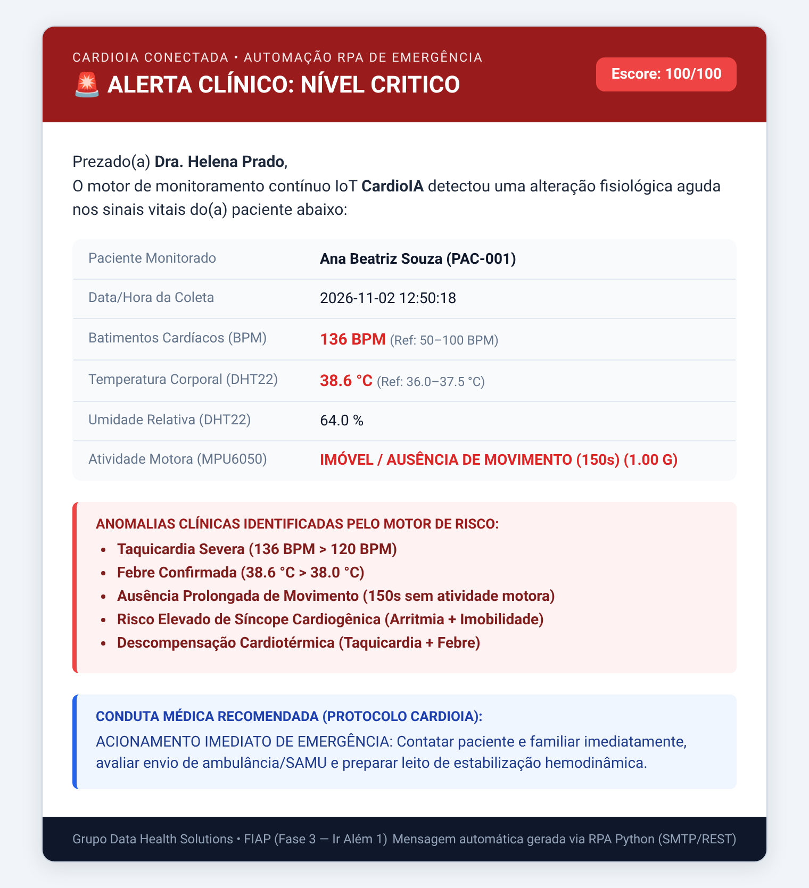

# FIAP - Faculdade de Informática e Administração Paulista

<p align="center">
<a href="https://www.fiap.com.br/"></a>
</p>

<br>

# CardioIA Conectada — Ir Além 1: Comunicação Automatizada com REST e E-mail (RPA)

## Grupo: Data Health Solutions

## 👨‍🎓 Integrantes:
- <a href="https://www.linkedin.com/in/gabriel-oliveira-b6353a16b/">Gabriel Oliveira dos Santos</a> — RM567166
- <a href="https://www.linkedin.com/in/arthur-bruttel-7171b8381">Arthur Bruttel Nascimento</a> — RM568484
- <a href="https://www.linkedin.com/in/jonviotti/">Jonatan Viotti Rodrigues da Silva</a> — RM566787
- <a href="https://www.linkedin.com/in/eusamuelrocha/">Samuel Nicolas Oliveira Rocha</a> — RM568552

## 👩‍🏫 Professores:
### Tutor(a)
- <a href="https://www.linkedin.com/in/leonardoorabona/">Leonardo Ruiz Orabona</a>
### Coordenador(a)
- <a href="https://www.linkedin.com/company/inova-fusca">André Godoi Chiovato</a>

---

## 📜 Descrição do Módulo

Este módulo contempla o desafio **Ir Além 1** da **Fase 3 do projeto CardioIA**: um sistema completo de monitoramento em Python que **envia (`POST`) e consome (`GET`) sinais vitais via API REST**, aplica um **motor multiparamétrico de detecção de riscos clínicos** (taquicardia, bradicardia, febre, hipotermia, queda brusca e ausência prolongada de movimento) e aciona automaticamente um **robô RPA de disparo de e-mails médicos (SMTP/HTML)** em caso de alerta.

| Entregável Solicitado | Onde Encontrar no Projeto |
| :--- | :--- |
| **Cliente REST para envio e recebimento de dados** | [`src/cliente_rest.py`](src/cliente_rest.py) (Classe `ClienteRESTCardioIA` com métodos `POST` e `GET` via `requests` + simulação completa de 6 cenários clínicos) |
| **Servidor API RESTful com persistência SQLite** | [`src/servidor_api.py`](src/servidor_api.py) (Endpoints FastAPI `/api/v1/sinais-vitais`, `/api/v1/alertas`, `/api/v1/pacientes`, `/api/v1/health`) |
| **Lógica de verificação de risco clínico** | [`src/motor_risco.py`](src/motor_risco.py) (Classe `AvaliadorRiscoCardioIA` com escore `0–100` e detecção sinérgica de anomalias) |
| **Automação de disparo de e-mail em caso de alerta (RPA)** | [`src/automacao_email_rpa.py`](src/automacao_email_rpa.py) (Disparo real via `smtplib.SMTP`, template HTML responsivo e trilha de auditoria em [`logs/emails_enviados/`](logs/emails_enviados/)) |
| **Suíte de Testes Automatizados (`pytest`)** | [`tests/test_rest_rpa.py`](tests/test_rest_rpa.py) |
| **Relatório Técnico Curto (1 a 2 páginas — MD e PDF)** | [`relatorios/Relatorio_IrAlem1_Comunicacao_REST_Automacao_Email.md`](relatorios/Relatorio_IrAlem1_Comunicacao_REST_Automacao_Email.md) / [`.pdf`](relatorios/Relatorio_IrAlem1_Comunicacao_REST_Automacao_Email.pdf) |

---

## 📧 Evidência do E-mail Automatizado Disparado pelo RPA

Quando uma leitura enviada pelo cliente REST ultrapassa os limiares seguros (ex.: Taquicardia `> 120 BPM`, Febre `> 38.0 °C` ou Ausência de Movimento), o robô RPA formata e envia automaticamente o alerta abaixo para o médico responsável pelo paciente:

<p align="center">
  
</p>

---

## 📁 Estrutura de Pastas

```text
Automacao_REST_Alertas_RPA/
├── assets/
│   ├── logo-fiap.png
│   └── preview_email_alerta.png                         # Captura real do e-mail HTML gerado pelo RPA
├── src/
│   ├── cliente_rest.py                                  # Cliente HTTP REST (POST/GET) e orquestrador da demonstração
│   ├── servidor_api.py                                  # API RESTful FastAPI + Banco SQLite
│   ├── motor_risco.py                                   # Lógica clínica de verificação de riscos (0 a 100 pts)
│   └── automacao_email_rpa.py                           # Robô RPA de envio de e-mail SMTP + Spooler HTML/EML/CSV
├── tests/
│   └── test_rest_rpa.py                                 # Testes automatizados de unidade e integração REST
├── logs/
│   ├── cardioia_monitoramento.db                        # Banco SQLite gerado automaticamente
│   ├── historico_disparos_rpa.csv                       # Log de auditoria de todos os e-mails disparados
│   └── emails_enviados/                                 # E-mails enviados (.html e .eml)
└── relatorios/
    ├── Relatorio_IrAlem1_Comunicacao_REST_Automacao_Email.md
    └── Relatorio_IrAlem1_Comunicacao_REST_Automacao_Email.pdf
```

---

## 🔧 Como Executar o Código

Pré-requisitos: Python 3.9+ e bibliotecas `fastapi`, `uvicorn`, `requests`, `pydantic` e `pytest`.

```bash
pip install fastapi uvicorn requests pydantic httpx pytest
```

### 1. Executar a Simulação Completa (Servidor API + Servidor SMTP Local + Cliente REST)
Basta executar o script `src/cliente_rest.py`. Ele inicia automaticamente a API REST na porta `8000` e um servidor SMTP local de homologação na porta `1025`, envia 6 cenários clínicos via `POST`, dispara os e-mails de alerta via SMTP e consome os resultados via `GET`:

```bash
python src/cliente_rest.py
```

### 2. Executar os Testes Automatizados (`pytest`)
```bash
pytest tests/test_rest_rpa.py -v
```

---

## 📋 Licença

<p xmlns:cc="http://creativecommons.org/ns#" xmlns:dct="http://purl.org/dc/terms/"><a property="dct:title" rel="cc:attributionURL" href="https://github.com/agodoi/template">MODELO GIT FIAP</a> por <a rel="cc:attributionURL dct:creator" property="cc:attributionName" href="https://fiap.com.br">Fiap</a> está licenciado sobre <a href="http://creativecommons.org/licenses/by/4.0/?ref=chooser-v1" target="_blank" rel="license noopener noreferrer" style="display:inline-block;">Attribution 4.0 International</a>.</p>
