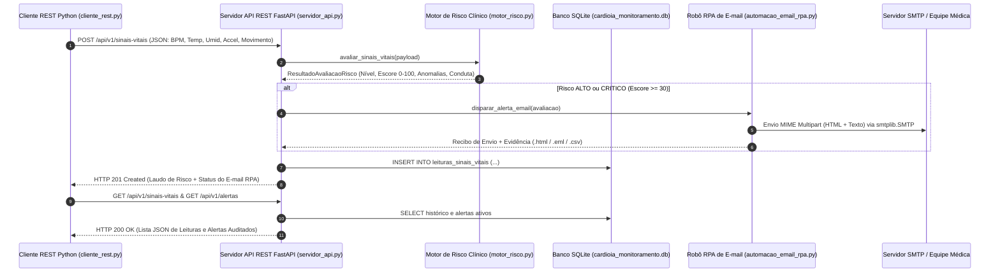
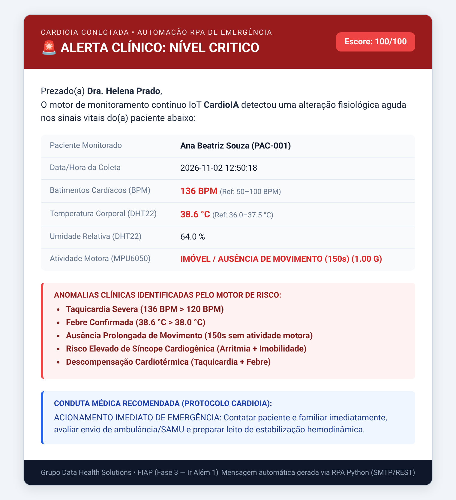

# FIAP — Faculdade de Informática e Administração Paulista

## Relatório Técnico — Ir Além 1: Comunicação Automatizada com API REST e Disparo de E-mail (RPA)

- **Projeto:** CardioIA Conectada — Fase 3: Monitoramento Contínuo (IoT na Saúde Digital)
- **Grupo:** Data Health Solutions
- **Integrantes:**
  - Gabriel Oliveira dos Santos — RM567166
  - Arthur Bruttel Nascimento — RM568484
  - Jonatan Viotti Rodrigues da Silva — RM566787
  - Samuel Nicolas Oliveira Rocha — RM568552
- **Tutor:** Leonardo Ruiz Orabona | **Coordenador:** André Godoi Chiovato

---

## 1. Objetivo e Arquitetura da Solução

O módulo **Ir Além 1** expande o monitoramento contínuo da Fase 3 do **CardioIA** conectando a camada de telemetria IoT a uma arquitetura **HTTP RESTful em Python** integrada a um motor de **Automação Robótica de Processos (RPA — *Robotic Process Automation*)** para notificação ativa de equipes médicas por e-mail em situações de emergência cardiológica.

---

## 2. Consumo e Envio de Dados via API REST (`servidor_api.py` e `cliente_rest.py`)

A comunicação HTTP foi estruturada em dois componentes complementares desenvolvidos em Python:

### 2.1. Servidor API REST (`src/servidor_api.py`)
Construído com **FastAPI**, validação estrita de schemas via **Pydantic** (`PayloadSinaisVitais`) e persistência relacional em **SQLite** (`logs/cardioia_monitoramento.db`), expondo os seguintes endpoints:
- `GET /api/v1/health`: Verifica a disponibilidade do serviço e retorna contadores em tempo real de leituras armazenadas e alertas disparados.
- `GET /api/v1/pacientes`: Retorna os 5 pacientes cardiológicos acompanhados desde a Fase 2 (*Ana Beatriz Souza*, *Carlos Eduardo Lima*, *Mariana Ferreira*, *João Pedro Almeida* e *Luiza Martins*), com seus respectivos diagnósticos de base e médicos responsáveis.
- `POST /api/v1/sinais-vitais`: Recebe leituras contendo `paciente_id`, `bpm`, `temperatura_c`, `umidade_pct`, `aceleracao_g`, `em_movimento` e `segundos_sem_movimento`. Aciona o motor de risco, dispara o robô RPA de e-mail se necessário e retorna `HTTP 201 Created`.
- `GET /api/v1/sinais-vitais`: Permite ao cliente REST consumir o histórico de leituras com filtros por `paciente_id`, `nivel_risco` e `limite`.
- `GET /api/v1/alertas`: Retorna exclusivamente os episódios clínicos que exigiram disparo de alerta médico.

### 2.2. Cliente REST (`src/cliente_rest.py`)
Implementado através da classe `ClienteRESTCardioIA` utilizando `requests.Session()`, mantendo cabeçalhos padronizados (`Content-Type: application/json`), controle de *timeout* e verificação de erros HTTP (`raise_for_status()`). O cliente realiza tanto o **envio ativo (`POST`)** de baterias de sinais vitais quanto o **consumo analítico (`GET`)** dos dados processados e alertas gerados pela API.

---

## 3. Lógica de Verificação de Riscos Clínicos (`motor_risco.py`)

A classe `AvaliadorRiscoCardioIA` implementa um sistema de pontuação multiparamétrico (`0 a 100 pontos`), inspirado no protocolo hospitalar **NEWS2 (*National Early Warning Score*)**, cruzando variáveis hemodinâmicas, térmicas e cinemáticas:

| Parâmetro Analisado | Condição / Limiar Clínico | Pontuação no Escore | Anomalia Diagnosticada |
| :--- | :--- | :---: | :--- |
| **Batimentos Cardíacos (BPM)** | `BPM > 120` | `+45 pts` | **Taquicardia Severa** |
| **Batimentos Cardíacos (BPM)** | `100 < BPM <= 120` | `+20 pts` | **Taquicardia Moderada** |
| **Batimentos Cardíacos (BPM)** | `BPM < 50` | `+45 pts` | **Bradicardia Crítica** |
| **Temperatura Corporal (°C)** | `Temp > 39,0 °C` | `+40 pts` | **Febre Alta / Hipertermia Severa** |
| **Temperatura Corporal (°C)** | `38,0 < Temp <= 39,0 °C` | `+30 pts` | **Febre Confirmada** |
| **Temperatura Corporal (°C)** | `Temp < 35,0 °C` | `+40 pts` | **Hipotermia Clínica** |
| **Movimento e Queda (MPU6050)** | `Accel >= 2,30 G` + Imóvel | `+50 pts` | **Impacto de Queda Brusca seguido de Imobilidade** |
| **Ausência de Movimento** | `em_movimento == False` ($\ge 120\text{s}$) | `+30 pts` | **Ausência Prolongada de Movimento** |
| **Umidade / Diaforese** | `Umidade >= 75%` + alteração vital | `+15 pts` | **Sudorese Profusa / Diaforese Detectada** |
| **Sinergia: Arritmia + Imobilidade** | (`BPM > 120` ou `< 50`) + Imóvel | `+25 pts` | **Risco Elevado de Síncope Cardiogênica** |
| **Sinergia: Taquicardia + Febre** | `BPM > 120` e `Temp > 38,0 °C` | `+20 pts` | **Descompensação Cardiotérmica** |

- **Regras de Decisão:**
  - `Escore < 15` → **BAIXO** (Monitoramento de rotina, sem disparo de e-mail).
  - `15 <= Escore < 30` → **MODERADO** (Observação ativa, sem disparo de e-mail).
  - `30 <= Escore < 60` → **ALTO** (**Aciona RPA de E-mail**: Intervenção médica prioritária / teleconsulta em até 15 min).
  - `Escore >= 60` → **CRÍTICO** (**Aciona RPA de E-mail com Prioridade Máxima `X-Priority: 1`**: Acionamento imediato de emergência / SAMU).

---

## 4. Automação RPA de Disparo de E-mail (`automacao_email_rpa.py`)

Quando o motor de risco sinaliza `requer_alerta_email = True`, a classe `AutomacaoEmailRPA` executa três etapas automatizadas:
1. **Construção do Laudo MIME Multipart (`multipart/alternative`):** Gera simultaneamente uma versão em texto puro e um e-mail **HTML responsivo** endereçado ao cardiologista responsável pelo paciente (ex.: *Dra. Helena Prado* para `PAC-001` ou *Dr. André Vasconcelos* para `PAC-002`), destacando em vermelho os parâmetros fora da faixa de referência, a lista de anomalias e a conduta clínica recomendada.
2. **Transmissão via Protocolo SMTP (`smtplib.SMTP`):** Envia o e-mail para o servidor SMTP configurado (`CARDIOIA_SMTP_HOST` / `CARDIOIA_SMTP_PORT`). Durante a execução de `cliente_rest.py`, um servidor SMTP TCP local (`ServidorSMTPLocalHomologacao` na porta `1025`) realiza o *handshake* SMTP completo (`EHLO`, `MAIL FROM`, `RCPT TO`, `DATA`, `250 OK`), comprovando o funcionamento real do protocolo de rede.
3. **Spooler Local e Trilha de Auditoria:** Salva cada e-mail enviado em `logs/emails_enviados/` nos formatos `.html` e `.eml` (RFC 5322) e registra o disparo em `logs/historico_disparos_rpa.csv`.

---

## 5. Conclusão

A integração entre **API REST (FastAPI + Requests)**, **Motor de Risco Multiparamétrico** e **RPA de E-mail (SMTP/MIME)** fecha o ciclo de resposta clínica do **CardioIA**: os dados capturados pelos sensores IoT deixam de ser apenas números passivos em um banco de dados e passam a acionar fluxos ativos de resposta médica imediata, reduzindo o tempo entre o início de um evento cardíaco agudo e a intervenção profissional.
