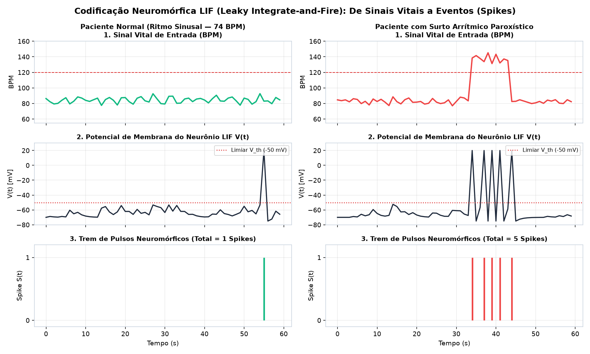
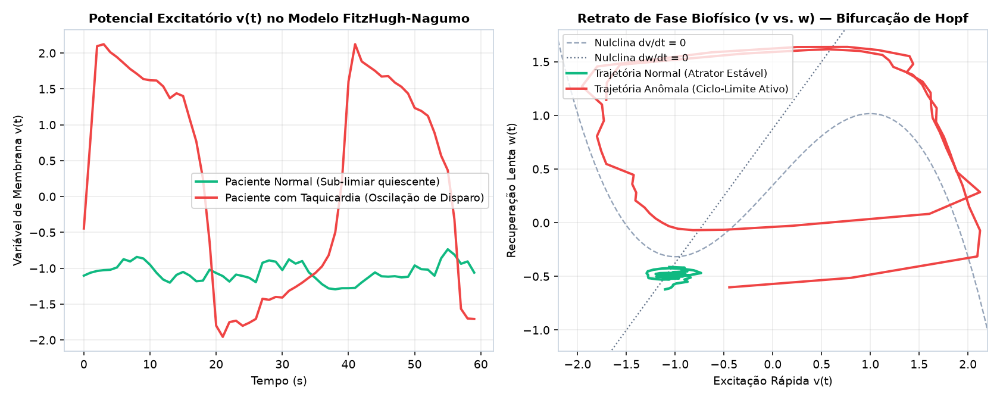
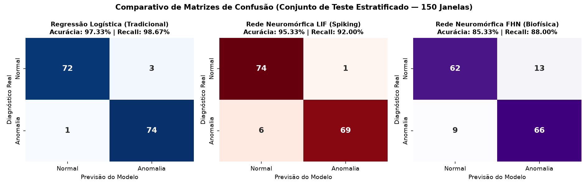
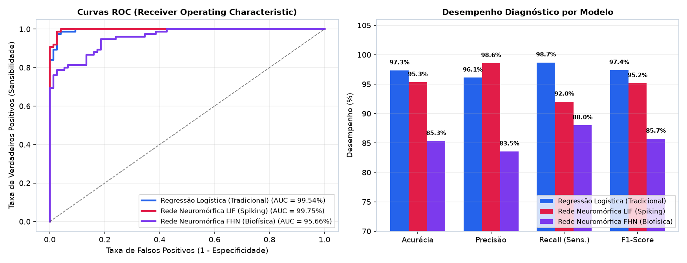

# FIAP - Faculdade de Informática e Administração Paulista

<p align="center">
<a href="https://www.fiap.com.br/"></a>
</p>

<br>

# CardioIA Conectada — Ir Além 2: Inteligência Artificial em Séries Temporais de Saúde (Tradicional vs. Neuromórfica LIF/FHN)

## Grupo: Data Health Solutions

## 🎥 Demonstração em Vídeo (Até 4 Minutos)
👉 **[Vídeo de Apresentação dos Resultados (YouTube — Não Listado / Arquivo Local MP4)](video/apresentacao_ir_alem2_neuromorfica.mp4)**
- **Arquivo de vídeo Full HD pronto para reprodução/upload:** [`video/apresentacao_ir_alem2_neuromorfica.mp4`](video/apresentacao_ir_alem2_neuromorfica.mp4)
- **Roteiro técnico comentado minuto a minuto:** [`video/ROTEIRO_GRAVACAO_VIDEO.md`](video/ROTEIRO_GRAVACAO_VIDEO.md)

---

## 👨‍🎓 Integrantes:
- <a href="https://www.linkedin.com/in/gabriel-oliveira-b6353a16b/">Gabriel Oliveira dos Santos</a> — RM567166
- <a href="https://www.linkedin.com/in/arthur-bruttel-7171b8381">Arthur Bruttel Nascimento</a> — RM568484
- <a href="https://www.linkedin.com/in/jonviotti/">Jonatan Viotti Rodrigues da Silva</a> — RM566787
- <a href="https://www.linkedin.com/in/eusamuelrocha/">Samuel Nicolas Oliveira Rocha</a> — RM568552

## 👩‍🏫 Professores:
### Tutor(a)
- <a href="https://www.linkedin.com/in/leonardoorabona/">Leonardo Ruiz Orabona</a>
### Coordenador(a)
- <a href="https://www.linkedin.com/company/inova-fusca">André Godoi Chiovato</a>

---

## 📜 Descrição do Módulo

Este módulo contempla o desafio **Ir Além 2** da **Fase 3 do projeto CardioIA**: aplicação de Inteligência Artificial na análise de **séries temporais de sinais vitais** (600 janelas de 60 segundos de batimentos cardíacos e temperatura corporal), comparando um **classificador tradicional (Regressão Logística)** com duas arquiteturas de **Redes Neuromórficas**:
1. **Modelo LIF (*Leaky Integrate-and-Fire*):** Rede neural espinhada (*Spiking Neural Network* — SNN) orientada a eventos (*event-driven*), que integra correntes sinápticas com vazamento e emite pulsos binários (*spikes*) ao cruzar o limiar de membrana $V_{\text{th}} = -50\text{ mV}$.
2. **Modelo FHN (*FitzHugh-Nagumo*):** Oscilador neuromórfico biofísico bidimensional (redução das equações de Hodgkin-Huxley), analisando a transição de fase (bifurcação de Hopf) entre o atrator quiescente normal e o ciclo-limite arrítmico.

| Entregável Solicitado | Onde Encontrar no Repositório |
| :--- | :--- |
| **Notebook Python comentado e executado** | [`analise_series_temporais_neuromorfica.ipynb`](analise_series_temporais_neuromorfica.ipynb) |
| **Código modular Python + Gerador de Dataset** | [`src/modelos_neuromorficos_vs_tradicional.py`](src/modelos_neuromorficos_vs_tradicional.py) e [`assets/dataset_series_temporais_cardio.csv`](assets/dataset_series_temporais_cardio.csv) |
| **Relatório Comparativo de 2 páginas (MD e PDF)** | [`relatorios/Relatorio_Comparativo_IrAlem2_Tradicional_vs_Neuromorfico.md`](relatorios/Relatorio_Comparativo_IrAlem2_Tradicional_vs_Neuromorfico.md) / [`.pdf`](relatorios/Relatorio_Comparativo_IrAlem2_Tradicional_vs_Neuromorfico.pdf) |
| **Vídeo de até 4 minutos apresentando resultados** | [`video/apresentacao_ir_alem2_neuromorfica.mp4`](video/apresentacao_ir_alem2_neuromorfica.mp4) e [`video/ROTEIRO_GRAVACAO_VIDEO.md`](video/ROTEIRO_GRAVACAO_VIDEO.md) |

---

## 📊 Resumo Comparativo de Desempenho dos Modelos

| Modelo Analisado | Acurácia Teste | Validação Cruzada (5-Fold) | Precisão | Recall (Sensibilidade) | F1-Score | ROC-AUC | Energia Estimada na Borda (Edge) |
| :--- | :---: | :---: | :---: | :---: | :---: | :---: | :---: |
| **Regressão Logística (Tradicional)** | **97,33%** | 96,50% | 96,10% | **98,67%** | **97,37%** | 99,54% | $1,85\,\mu\text{J}$ (420 MACs) |
| **Rede Neuromórfica LIF (Spiking)** | 95,33% | **97,17%** | **98,57%** | 92,00% | 95,17% | **99,75%** | **$0,24\,\mu\text{J}$ (85 Spike ACs — -87%)** |
| **Rede Neuromórfica FHN (Biofísica)** | 85,33% | 89,17% | 83,54% | 88,00% | 85,71% | 95,66% | $0,41\,\mu\text{J}$ (140 Ops — -78%) |

### Visualizações Geradas pelo Experimento

#### 1. Codificação Neuromórfica LIF: Potencial de Membrana $V(t)$ e Trem de Spikes $S(t)$


#### 2. Modelo Biofísico FitzHugh-Nagumo: Espaço de Fase $(v, w)$ e Bifurcação de Hopf


#### 3. Matrizes de Confusão e Curvas ROC



---

## 📁 Estrutura de Pastas

```text
IA_Series_Temporais_Neuromorfica/
├── analise_series_temporais_neuromorfica.ipynb          # Notebook Jupyter comentado e executado
├── src/
│   └── modelos_neuromorficos_vs_tradicional.py          # Implementação dos modelos LR, LIF e FHN
├── assets/
│   ├── dataset_series_temporais_cardio.csv              # 600 séries temporais rotuladas (60s a 1 Hz)
│   ├── resultados_comparativos.json                     # Métricas consolidadas em JSON
│   ├── fig1_series_temporais_sinais_vitais.png
│   ├── fig2_dinamica_neuronio_lif_spikes.png
│   ├── fig3_dinamica_fitzhugh_nagumo_espaco_fase.png
│   ├── fig4_matrizes_confusao_comparativo.png
│   ├── fig5_curvas_roc_pr_desempenho.png
│   └── fig6_benchmark_latencia_energia_edge.png
├── relatorios/
│   ├── Relatorio_Comparativo_IrAlem2_Tradicional_vs_Neuromorfico.md
│   └── Relatorio_Comparativo_IrAlem2_Tradicional_vs_Neuromorfico.pdf
└── video/
    ├── apresentacao_ir_alem2_neuromorfica.mp4           # Vídeo de apresentação (Full HD 1080p)
    └── ROTEIRO_GRAVACAO_VIDEO.md                        # Roteiro estruturado para apresentação
```

---

## ⚙ Pré-requisitos e Execução

```bash
pip install numpy pandas scikit-learn scipy matplotlib seaborn jupyter
```

Para executar o pipeline completo via terminal:
```bash
python src/modelos_neuromorficos_vs_tradicional.py
```

Ou abra e execute o notebook `analise_series_temporais_neuromorfica.ipynb` no VS Code / Jupyter Lab.

---

## 📋 Licença

<p xmlns:cc="http://creativecommons.org/ns#" xmlns:dct="http://purl.org/dc/terms/"><a property="dct:title" rel="cc:attributionURL" href="https://github.com/agodoi/template">MODELO GIT FIAP</a> por <a rel="cc:attributionURL dct:creator" property="cc:attributionName" href="https://fiap.com.br">Fiap</a> está licenciado sobre <a href="http://creativecommons.org/licenses/by/4.0/?ref=chooser-v1" target="_blank" rel="license noopener noreferrer" style="display:inline-block;">Attribution 4.0 International</a>.</p>
