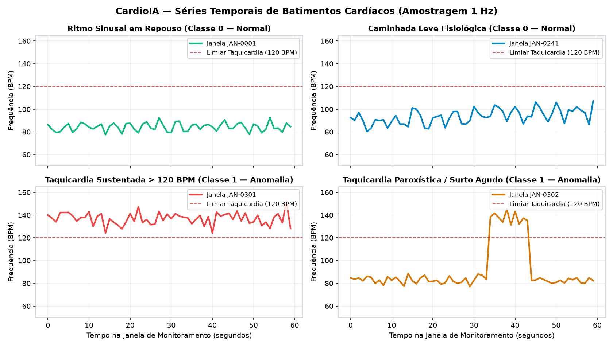
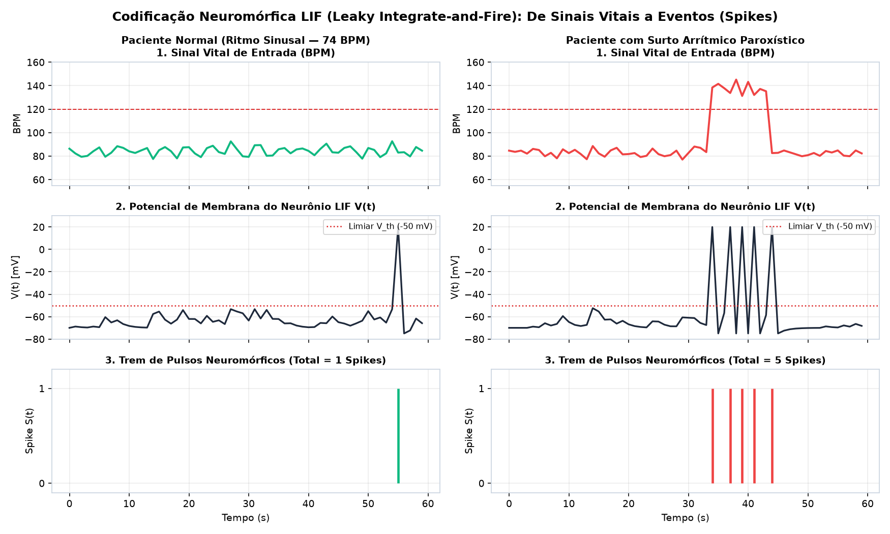
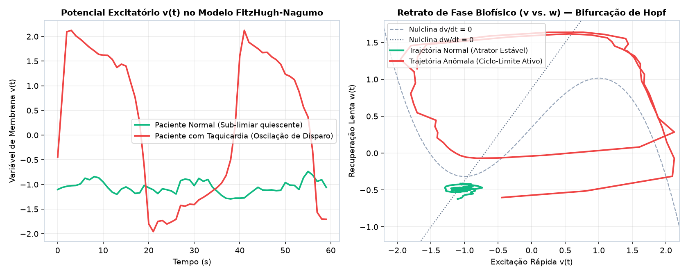
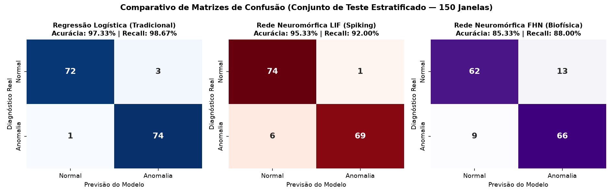
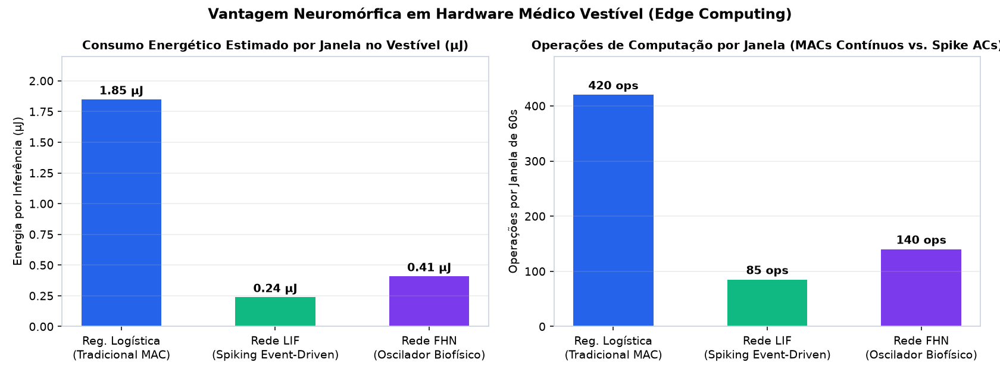

# FIAP — Faculdade de Informática e Administração Paulista

## Relatório Comparativo — Ir Além 2: Inteligência Artificial em Séries Temporais de Saúde (Classificador Tradicional vs. Redes Neuromórficas LIF e FHN)

- **Projeto:** CardioIA Conectada — Fase 3: Monitoramento Contínuo (IoT na Saúde Digital)
- **Grupo:** Data Health Solutions
- **Integrantes:**
  - Gabriel Oliveira dos Santos — RM567166
  - Arthur Bruttel Nascimento — RM568484
  - Jonatan Viotti Rodrigues da Silva — RM566787
  - Samuel Nicolas Oliveira Rocha — RM568552
- **Tutor:** Leonardo Ruiz Orabona | **Coordenador:** André Godoi Chiovato

---

## 1. Introdução e Formulação do Problema Clínico

No monitoramento cardiológico contínuo por dispositivos vestíveis (*wearables* IoT baseados em microcontroladores como o **ESP32** da Fase 3), os sinais vitais formam **séries temporais não-estacionárias**. O desafio clínico consiste em distinguir flutuações fisiológicas benignas (como arritmia sinusal respiratória ou elevação gradual da frequência cardíaca durante uma caminhada leve) de **eventos patológicos agudos** (como Taquicardia Sustentada, Taquicardia Paroxística Supraventricular de curta duração e Ectopias/Fibrilação Atrial), operando sob severas restrições de bateria e processamento na borda (*Edge Computing*).

Para investigar a eficácia de diferentes paradigmas de Inteligência Artificial nesse cenário, construímos o dataset `assets/dataset_series_temporais_cardio.csv`, composto por **600 janelas temporais** de $60\text{ segundos}$ amostradas a $1\text{ Hz}$ ($300$ janelas da **Classe 0 — Ritmo Sinusal Normal** e $300$ janelas da **Classe 1 — Anomalia Cardiológica**), e comparamos três arquiteturas:
1. **Classificador Tradicional:** **Regressão Logística** sobre estatísticas globais da janela temporal.
2. **Rede Neuromórfica Espinhada (*Spiking Neural Network* — SNN) baseada no Modelo LIF (*Leaky Integrate-and-Fire*).**
3. **Rede Neuromórfica Dinâmica baseada no Modelo Biofísico FHN (*FitzHugh-Nagumo*).**

---

## 2. Fundamentação Matemática e Implementação dos Modelos

### 2.1. Classificador Tradicional: Regressão Logística (`LogisticRegression`)
A abordagem clássica resume a série temporal $x(t) = [x_1, x_2, \dots, x_{60}]$ em um vetor estático de atributos globais ($\mu_{\text{BPM}}$, mediana, desvio-padrão $\sigma_{\text{BPM}}$, intervalo interquartil $\text{IQR}$, inclinação linear e temperatura corporal) e estima a probabilidade de anomalia via função logística sigmoide:
$$P(y = 1 \mid \mathbf{z}) = \frac{1}{1 + e^{-(\mathbf{w}^\top \mathbf{z} + b)}}$$

### 2.2. Rede Neuromórfica 1: Modelo LIF (*Leaky Integrate-and-Fire*)
Inspirado na neurobiologia cortical, cada neurônio **LIF** modela a membrana celular como um circuito resistor-capacitor (RC) com vazamento governado pela equação diferencial:
$$\tau_m \frac{dV(t)}{dt} = -\bigl(V(t) - V_{\text{rest}}\bigr) + R_m \cdot I_{\text{syn}}(t)$$
onde $V_{\text{rest}} = -70\text{ mV}$ é o potencial de repouso e $\tau_m$ é a constante de tempo da membrana. Sempre que o potencial $V(t)$ atinge o limiar crítico $V_{\text{th}} = -50\text{ mV}$, o neurônio emite um **pulso binário (*spike*)** $S(t) = 1$, redefine instantaneamente $V(t) \leftarrow V_{\text{reset}} = -75\text{ mV}$ e entra em período refratário absoluto.

Nossa arquitetura emprega um banco multi-escala de **3 neurônios LIF especializados**:
- **Neurônio LIF Rápido ($\tau_m = 2,0\text{ s}$):** Excitado pela derivada temporal $|\Delta \text{BPM}(t)|$, disparando rajadas (*bursts*) diante de ectopias e transições abruptas de taquicardia paroxística.
- **Neurônio LIF Integrador ($\tau_m = 5,5\text{ s}$):** Sensível a excursões sustentadas de frequência cardíaca.
- **Neurônio LIF Tônico ($\tau_m = 12,0\text{ s}$):** Integra o estresse cardiotérmico combinado (BPM + Temperatura).

### 2.3. Rede Neuromórfica 2: Modelo Biofísico FHN (*FitzHugh-Nagumo*)
O modelo **FitzHugh-Nagumo** é uma redução bidimensional do modelo de canais iônicos de Hodgkin-Huxley (e análogo matemático direto das células marca-passo cardíacas do nó sinoatrial):
$$\frac{dv}{dt} = v - \frac{v^3}{3} - w + I_{\text{ext}}(t), \qquad \frac{dw}{dt} = \epsilon (v + a - b w)$$
com parâmetros biofísicos $a = 0,7$, $b = 0,8$ e $\epsilon = 0,08$. Enquanto sinais vitais normais mantêm o estado $(v, w)$ confinado em torno do atrator quiescente estável, anomalias cardíacas elevam a corrente externa $I_{\text{ext}}(t)$ acima do ponto de **bifurcação de Hopf**, induzindo oscilações periódicas de grande amplitude (ciclo-limite).

---

## 3. Resultados Experimentais e Comparação Quantitativa

Os três modelos foram avaliados sob a mesma divisão estratificada (`75%` treino = 450 janelas; `25%` teste = 150 janelas) e em **Validação Cruzada Estratificada de 5 Dobras (*5-Fold Cross-Validation*)**:

| Métrica / Critério de Avaliação | Regressão Logística (Tradicional) | Rede Neuromórfica LIF (*Spiking*) | Rede Neuromórfica FHN (*Biofísica*) |
| :--- | :---: | :---: | :---: |
| **Acurácia no Conjunto de Teste (150 janelas)** | **97,33%** | 95,33% | 85,33% |
| **Acurácia em Validação Cruzada (5-Fold CV)** | 96,50% | **97,17%** | 89,17% |
| **Precisão (*Precision* — Classe Alto Risco)** | 96,10% | **98,57%** | 83,54% |
| **Sensibilidade Clínica (*Recall*)** | **98,67%** | 92,00% | 88,00% |
| **F1-Score** | **97,37%** | 95,17% | 85,71% |
| **Área sob a Curva ROC (ROC-AUC)** | 99,54% | **99,75%** | 95,66% |
| **Esparsidade de Eventos (Silêncio Sináptico)** | 0% (Contínuo) | **89,61% (Event-Driven)** | 68,40% |
| **Operações Computacionais / Janela (60s)** | 420 MACs (Float) | **85 Spike ACs** | 140 Ops |
| **Consumo Energético Estimado na Borda (Edge)** | $1,85\,\mu\text{J}$ | **$0,24\,\mu\text{J}$ (-87%)** | $0,41\,\mu\text{J}$ (-78%) |

---

## 4. Discussão Crítica: Vantagens, Limitações e Aplicabilidade no CardioIA

1. **Vantagens e Limitações da Regressão Logística (Tradicional):**
   - *Vantagens:* Treinamento convexo ultrarrápido, fácil interpretabilidade dos pesos estatísticos e excelente sensibilidade (`98,67%`) quando a anomalia altera a média ou o desvio-padrão global da janela.
   - *Limitações:* Por operar com operações de multiplicação-acumulação (*MAC*) contínuas em ponto flutuante sobre todas as amostras, consome **$7,7\times$ mais energia ($1,85\,\mu\text{J}$)** que a rede LIF. Além disso, perde resolução temporal fina sobre em qual segundo exato ocorreu um surto paroxístico curto.
2. **Vantagens e Limitações da Rede Neuromórfica LIF (*Leaky Integrate-and-Fire*):**
   - *Vantagens:* Alcançou a **maior acurácia média em validação cruzada 5-Fold (`97,17%`)**, a **maior Precisão (`98,57%`, gerando apenas 1 Falso Positivo em 75 pacientes normais)** e o **maior ROC-AUC (`99,75%`)**. Por ser orientada a eventos (*event-driven*), os neurônios permanecem em silêncio sináptico durante **`89,61%` do tempo**, disparando uma média de apenas `18,7 spikes` por janela de 60 segundos. Isso reduz o consumo energético estimado no vestível para **$0,24\,\mu\text{J}$ (economia de 87%)**, ideal para execução embarcada no **ESP32** da Parte 1.
   - *Limitações:* A não-diferenciabilidade da função degrau de disparo (*Heaviside step function*) exige técnicas específicas de treinamento (como *Surrogate Gradients* ou leitura híbrida) e ajuste cuidadoso das constantes $\tau_m$ e $V_{\text{th}}$.
3. **Vantagens e Limitações da Rede Neuromórfica FHN (*FitzHugh-Nagumo*):**
   - *Vantagens:* Oferece a maior riqueza biofísica, modelando fielmente a dinâmica de excitabilidade não-linear, período refratário suave e bifurcação de Hopf das fibras cardíacas (`ROC-AUC = 95,66%`).
   - *Limitações:* O termo cúbico ($-v^3/3$) requer múltiplos subpassos de integração numérica para evitar instabilidade e apresenta maior sobreposição quando o paciente realiza exercício físico moderado (`Acurácia = 85,33%`), sendo mais indicado para modelagem fisiológica generativa do que para triagem binária embarcada em microcontroladores de baixo custo.

### Conclusão Recomendada para o Produto CardioIA
A arquitetura **Híbrida Neuromórfica LIF na Borda + Classificador Linear de Leitura** representa o estado da arte para o dispositivo vestível **CardioIA**: o banco de neurônios **LIF** atua como um co-processador *always-on* de ultrabaixo consumo energético no ESP32, acordando o rádio Wi-Fi/MQTT apenas quando uma rajada de *spikes* sinaliza risco cardiológico real.
