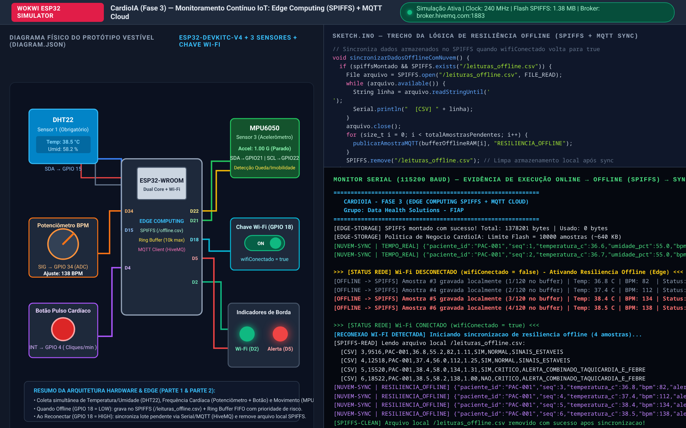
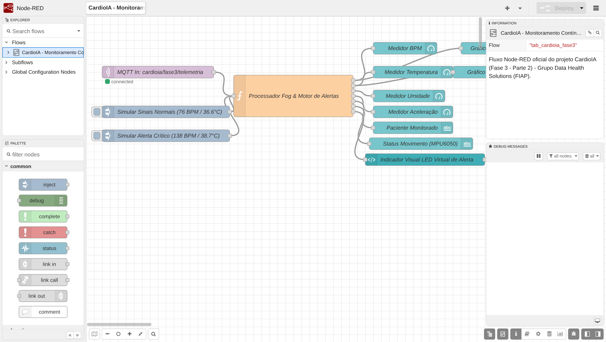
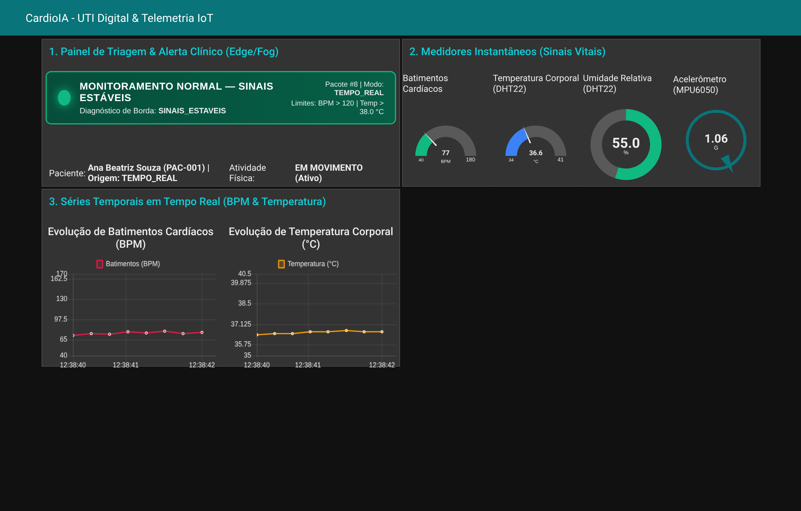
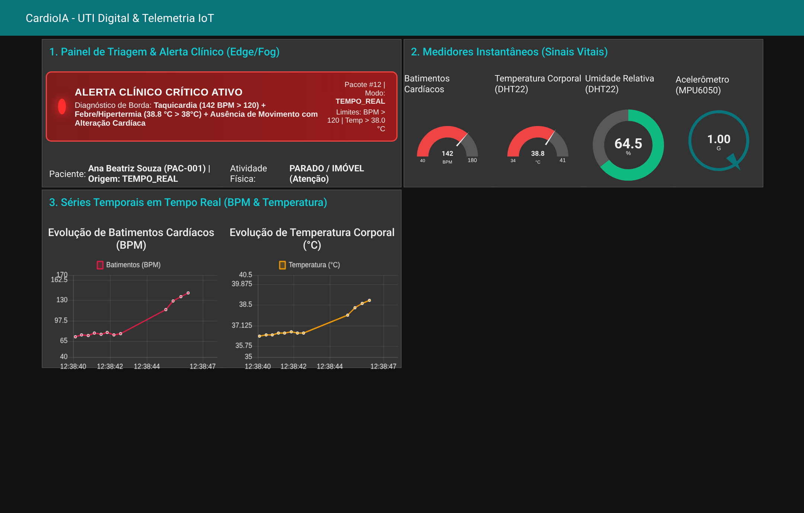

# FIAP - Faculdade de Informática e Administração Paulista

<p align="center">
<a href="https://www.fiap.com.br/"></a>
</p>

<br>

# CardioIA Conectada — Monitoramento Contínuo IoT (Fase 3: Parte 1 e Parte 2)

## Grupo: Data Health Solutions

## 👨‍🎓 Integrantes:
- <a href="https://www.linkedin.com/in/gabriel-oliveira-b6353a16b/">Gabriel Oliveira dos Santos</a> — RM567166
- <a href="https://www.linkedin.com/in/arthur-bruttel-7171b8381">Arthur Bruttel Nascimento</a> — RM568484
- <a href="https://www.linkedin.com/in/jonviotti/">Jonatan Viotti Rodrigues da Silva</a> — RM566787
- <a href="https://www.linkedin.com/in/eusamuelrocha/">Samuel Nicolas Oliveira Rocha</a> — RM568552

## 👩‍🏫 Professores:
### Tutor(a)
- <a href="https://www.linkedin.com/in/leonardoorabona/">Leonardo Ruiz Orabona</a>
### Coordenador(a)
- <a href="https://www.linkedin.com/company/inova-fusca">André Godoi Chiovato</a>

---

## 📜 Descrição do Módulo

Este módulo contempla a **Atividade Principal (Parte 1 e Parte 2)** da **Fase 3 do projeto CardioIA**: um protótipo funcional completo de sistema vestível (*wearable*) para monitoramento cardiológico contínuo que integra **Edge Computing (ESP32 + SPIFFS + Buffer Circular)**, **Fog/Cloud Computing (Protocolo MQTT via Broker HiveMQ)** e **Visualização Interativa em Tempo Real (Node-RED Dashboard e Grafana Cloud)**.

A solução dá continuidade direta à jornada clínica da Fase 2, acompanhando continuamente pacientes triados como **Alto Risco** no *CardioIA Portal* (como a paciente *Ana Beatriz Souza*, `PAC-001`, portadora de Síndrome Coronariana Aguda).

| Etapa da Atividade | Entregáveis e Onde Encontrar |
| :--- | :--- |
| **Parte 1 — Edge Computing, Sensores e Resiliência Offline (SPIFFS)** | • **Projeto Wokwi / Código C++ comentado:** [`parte1_edge_spiffs/sketch.ino`](parte1_edge_spiffs/sketch.ino) e [`parte1_edge_spiffs/diagram.json`](parte1_edge_spiffs/diagram.json)<br>• **Log de execução Serial (Online → Offline → Sync):** [`parte1_edge_spiffs/saida_serial_exemplo.txt`](parte1_edge_spiffs/saida_serial_exemplo.txt)<br>• **Relatório Técnico Parte 1 (MD e PDF):** [`relatorios/Relatorio_Parte1_Edge_Computing_Resiliencia.md`](relatorios/Relatorio_Parte1_Edge_Computing_Resiliencia.md) / [`.pdf`](relatorios/Relatorio_Parte1_Edge_Computing_Resiliencia.pdf) |
| **Parte 2 — Transmissão MQTT (Fog/Cloud) e Dashboard Node-RED** | • **Código ESP32 com MQTT + Resiliência:** [`parte2_mqtt_cloud/sketch.ino`](parte2_mqtt_cloud/sketch.ino) e [`parte2_mqtt_cloud/diagram.json`](parte2_mqtt_cloud/diagram.json)<br>• **Simulador Python MQTT para testes rápidos:** [`parte2_mqtt_cloud/simulador_esp32_mqtt.py`](parte2_mqtt_cloud/simulador_esp32_mqtt.py)<br>• **Export oficial do Dashboard Node-RED:** [`dashboard_nodered/flows_nodered.json`](dashboard_nodered/flows_nodered.json)<br>• **Export opcional do Dashboard Grafana Cloud:** [`dashboard_nodered/grafana_dashboard.json`](dashboard_nodered/grafana_dashboard.json)<br>• **Relatório Técnico Parte 2 (MD e PDF):** [`relatorios/Relatorio_Parte2_MQTT_Fog_Cloud_Dashboard.md`](relatorios/Relatorio_Parte2_MQTT_Fog_Cloud_Dashboard.md) / [`.pdf`](relatorios/Relatorio_Parte2_MQTT_Fog_Cloud_Dashboard.pdf) |

---

## 🛠️ Parte 1 — Armazenamento e Processamento Local (Edge Computing)

### Sensores Integrados no Protótipo Wokwi (ESP32)
1. **Sensor 1 (Obrigatório) — DHT22 (`GPIO 15`):** Mede periodicamente a **Temperatura Corporal/Superficial (°C)** e a **Umidade Relativa (%)**.
2. **Sensor 2 — Monitor de Batimentos Cardíacos (`GPIO 34` ADC + `GPIO 4` Botão de Pulso):** Combina um potenciômetro analógico (`40 a 175 BPM`) com um botão de pressão com interrupção de hardware (`isrBotaoPulso`), permitindo simular batimentos cardíacos apertando o botão *x* vezes por minuto.
3. **Sensor 3 — Acelerômetro e Giroscópio MPU6050 (`GPIO 21/22` I2C):** Mede a aceleração 3D em unidades gravitacionais (`G`), detectando **atividade física** ou **imobilidade prolongada / risco de síncope**.
4. **Chave Deslizante de Conectividade Wi-Fi (`GPIO 18`):** Controla fisicamente a variável booleana `wifiConectado` (`true` = Online / `false` = Offline), além de aceitar os comandos `offline` e `online` via Monitor Serial.
5. **LEDs de Status na Borda (`GPIO 2` Verde e `GPIO 5` Vermelho):** O LED Verde indica conexão Wi-Fi/MQTT ativa; o LED Vermelho aciona imediatamente na borda em caso de anomalia clínica, mesmo sem internet.

### Estratégia de Resiliência Offline e Dimensionamento de Negócio
- **Dupla Persistência (`SPIFFS` + `Buffer Circular em RAM`):** Quando `wifiConectado == false`, cada leitura é gravada no arquivo `/leituras_offline.csv` da partição Flash **SPIFFS** (para chips ESP32 reais) e espelhada em um **Buffer Circular em RAM** com log no **Monitor Serial** (contornando a volatilidade do SPIFFS nos simuladores).
- **Dimensionamento Alinhado ao Modelo de Negócio:** Cada registro CSV ocupa **~64 bytes**. Na partição SPIFFS do ESP32 (`1,38 MB` úteis), estabeleceu-se o teto de negócio de **10.000 amostras (~640 KB)**, garantindo **13,8 horas de autonomia offline contínua** (a 1 amostra a cada 5s). Caso a desconexão ultrapasse o limite do buffer, aplica-se a política **FIFO com Retenção Prioritária de Risco** (nunca sobrescrevendo amostras marcadas com `alerta_critico == true`).
- **Sincronização e Limpeza Automática:** Quando `wifiConectado` retorna para `true`, o ESP32 lê `/leituras_offline.csv`, descarrega todas as leituras acumuladas para a nuvem via `Serial.println` / MQTT (`"origem_envio": "RESILIENCIA_OFFLINE"`) e apaga o arquivo local com `SPIFFS.remove("/leituras_offline.csv")`.



---

## ☁️ Parte 2 — Transmissão MQTT (Fog/Cloud) e Dashboard Node-RED

### Comunicação MQTT (Broker HiveMQ)
O ESP32 conecta-se ao broker MQTT **`broker.hivemq.com` (porta `1883`)** e publica telemetria em tempo real nos tópicos:
- `cardioia/fase3/telemetria`: Payload JSON completo com sinais vitais, diagnóstico de borda e flag de alerta.
- `cardioia/fase3/alertas`: Canal exclusivo acionado imediatamente quando limites críticos são violados.
- `cardioia/fase3/bpm`, `cardioia/fase3/temperatura`, `cardioia/fase3/umidade`: Subtópicos numéricos diretos.
- `cardioia/fase3/status`: Mensagem *Last Will and Testament (LWT)* indicando disponibilidade `ONLINE` / `OFFLINE`.

### Prints Evidenciando a Aplicação no Node-RED

#### 1. Fluxo MQTT e Motor de Alertas no Editor do Node-RED (`flows_nodered.json`)


#### 2. Dashboard Node-RED em Operação Normal (Sinais Vitais Estáveis — LED Verde)


#### 3. Dashboard Node-RED em Estado de Alerta Clínico Crítico (`BPM > 120` e `Temp > 38 °C` — LED Vermelho)


---

## 📁 Estrutura de Pastas

```text
Monitoramento_Continuo_IoT/
├── assets/                                              # Prints do Wokwi, Node-RED e diagramas
│   ├── circuito_wokwi_diagrama.png
│   ├── simulacao_wokwi_serial_resiliencia.png
│   ├── nodered_fluxo_mqtt.png
│   ├── nodered_dashboard_normal.png
│   └── nodered_dashboard_alerta.png
├── parte1_edge_spiffs/                                  # Entregáveis de Código e Circuito da Parte 1
│   ├── sketch.ino                                       # Firmware C++ (DHT22 + BPM + MPU6050 + SPIFFS)
│   ├── diagram.json                                     # Circuito Wokwi completo da Parte 1
│   ├── libraries.txt                                    # Bibliotecas do Wokwi
│   ├── platformio.ini                                   # Configuração PlatformIO / VS Code
│   ├── wokwi.toml                                       # Configuração Wokwi CLI / VS Code
│   └── saida_serial_exemplo.txt                         # Evidência do Monitor Serial (Online/Offline/Sync)
├── parte2_mqtt_cloud/                                   # Entregáveis de Código e Circuito da Parte 2
│   ├── sketch.ino                                       # Firmware C++ com WiFi + MQTT HiveMQ + SPIFFS Sync
│   ├── diagram.json                                     # Circuito Wokwi completo da Parte 2
│   ├── libraries.txt                                    # Bibliotecas Wokwi (incluindo PubSubClient e ArduinoJson)
│   ├── platformio.ini                                   # Configuração PlatformIO
│   ├── wokwi.toml                                       # Configuração Wokwi
│   └── simulador_esp32_mqtt.py                          # Simulador Python MQTT para alimentar o Node-RED
├── dashboard_nodered/                                   # Exports de Dashboards (Fog/Cloud)
│   ├── flows_nodered.json                               # Fluxo completo do Node-RED Dashboard
│   └── grafana_dashboard.json                           # Dashboard opcional para Grafana Cloud
└── relatorios/                                          # Relatórios Técnicos (Markdown + PDF)
    ├── Relatorio_Parte1_Edge_Computing_Resiliencia.md
    ├── Relatorio_Parte1_Edge_Computing_Resiliencia.pdf
    ├── Relatorio_Parte2_MQTT_Fog_Cloud_Dashboard.md
    └── Relatorio_Parte2_MQTT_Fog_Cloud_Dashboard.pdf
```

---

## 🔧 Como Executar o Projeto

### 1. Executando no Simulador Wokwi (Web ou VS Code)
1. Acesse [https://wokwi.com/projects/new/esp32](https://wokwi.com/projects/new/esp32) (ou abra a pasta `parte1_edge_spiffs` / `parte2_mqtt_cloud` com a extensão **Wokwi Simulator** no VS Code).
2. Cole o conteúdo de `sketch.ino`, `diagram.json` e `libraries.txt`.
3. Clique em **Start the Simulation**:
   - Mova o controle do **DHT22** (`> 38 °C`) ou gire o **Potenciômetro / aperte o Botão de Pulso** (`> 120 BPM`) para acionar o **LED Vermelho de Alerta Clínico**.
   - Alterne a **Chave Deslizante Wi-Fi (`GPIO 18`)** para simular a queda de conexão, observar a gravação offline no **SPIFFS (`/leituras_offline.csv`)** e, ao religar a chave, acompanhar a **sincronização automática em lote** e exclusão do arquivo local!

### 2. Executando o Dashboard no Node-RED
1. Inicie o Node-RED (`npx node-red`) e instale o pacote `node-red-dashboard` no *Manage Palette*.
2. No menu superior direito, clique em **Import** e selecione o arquivo [`dashboard_nodered/flows_nodered.json`](dashboard_nodered/flows_nodered.json).
3. Clique em **Deploy** e acesse `http://localhost:1880/ui`.
4. Para alimentar o dashboard imediatamente via MQTT (sem precisar estar com o Wokwi aberto), execute o simulador Python:
   ```bash
   python parte2_mqtt_cloud/simulador_esp32_mqtt.py --broker broker.hivemq.com --modo ciclo
   ```

---

## 📋 Licença

<p xmlns:cc="http://creativecommons.org/ns#" xmlns:dct="http://purl.org/dc/terms/"><a property="dct:title" rel="cc:attributionURL" href="https://github.com/agodoi/template">MODELO GIT FIAP</a> por <a rel="cc:attributionURL dct:creator" property="cc:attributionName" href="https://fiap.com.br">Fiap</a> está licenciado sobre <a href="http://creativecommons.org/licenses/by/4.0/?ref=chooser-v1" target="_blank" rel="license noopener noreferrer" style="display:inline-block;">Attribution 4.0 International</a>.</p>
