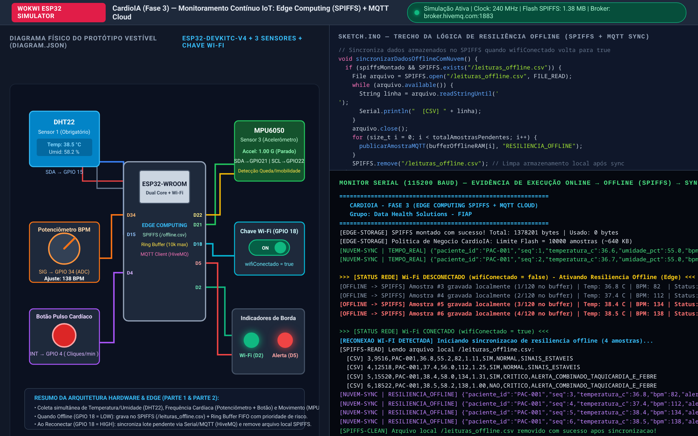
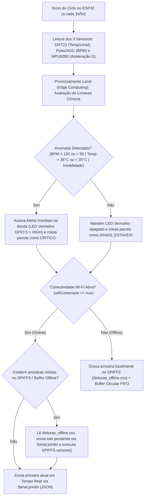

# FIAP — Faculdade de Informática e Administração Paulista

## Relatório Técnico — Parte 1: Armazenamento e Processamento Local (Edge Computing e Resiliência Offline)

- **Projeto:** CardioIA Conectada — Fase 3: Monitoramento Contínuo (IoT na Saúde Digital)
- **Grupo:** Data Health Solutions
- **Integrantes:**
  - Gabriel Oliveira dos Santos — RM567166
  - Arthur Bruttel Nascimento — RM568484
  - Jonatan Viotti Rodrigues da Silva — RM566787
  - Samuel Nicolas Oliveira Rocha — RM568552
- **Tutor:** Leonardo Ruiz Orabona | **Coordenador:** André Godoi Chiovato

---

## 1. Introdução e Contextualização no Ecossistema CardioIA

Na Fase 2 do projeto **CardioIA**, o grupo *Data Health Solutions* estruturou o motor de apoio ao diagnóstico (*Estetoscópio Digital*), o modelo de Machine Learning para triagem de risco clínico (*Classificador de Texto*) e o portal médico (*CardioIA Portal*). Agora, na **Fase 3**, o ecossistema evolui para o monitoramento fisiológico contínuo em tempo real por meio de **Internet das Coisas Médicas (IoMT — Internet of Medical Things)** e **Computação na Borda (Edge Computing)**.

Em pacientes cardiológicos classificados como **Alto Risco** (como a paciente *Ana Beatriz Souza*, 58 anos, portadora de Síndrome Coronariana Aguda acompanhada desde a Fase 2), a dependência exclusiva de conectividade com a nuvem para detectar uma emergência clínica ou para registrar sinais vitais representa um risco inaceitável. Caso o sinal Wi-Fi residencial oscile ou o paciente se desloque por áreas de sombra de cobertura, um dispositivo puramente dependente de nuvem perderia amostras críticas de arritmia, taquicardia ou síncope.

Para solucionar esse desafio, a **Parte 1** implementa um protótipo de dispositivo vestível baseado no microcontrolador **ESP32** simulado no **Wokwi**, dotado de processamento local de regras médicas na borda (*Edge Analytics*) e armazenamento local resiliente utilizando o sistema de arquivos **SPIFFS** (*SPI Flash File System*) aliado a um **Buffer Circular em RAM** e auditoria via **Monitor Serial**.

---

## 2. Arquitetura de Hardware e Sensores do Dispositivo Vestível (Wokwi)

O circuito eletrônico projetado no simulador Wokwi (`parte1_edge_spiffs/diagram.json`) supera o requisito mínimo de dois sensores distintos ao integrar **três subsistemas sensores fisiológicos e cinemáticos**, uma **chave física de simulação de conectividade Wi-Fi** e **dois indicadores luminosos de estado na borda**:

| Componente no Wokwi | Pino no ESP32 | Papel Funcional no Vestível CardioIA |
| :--- | :--- | :--- |
| **1. Sensor DHT22** *(Obrigatório)* | `GPIO 15` (Digital SDA) | Mede periodicamente a **Temperatura Corporal/Superficial (°C)** e a **Umidade Relativa (%)**, permitindo identificar quadros febris/hipertermia (`> 38,0 °C`), hipotermia (`< 35,0 °C`) e sudorese fria associada a eventos coronarianos. |
| **2. Monitor Cardíaco (Potenciômetro + Botão de Pulso)** | `GPIO 34` (ADC 12 bits) e `GPIO 4` (Interrupção) | Simula a captura de **Batimentos Cardíacos por Minuto (BPM)**. Combina uma base analógica ajustável (`40 a 175 BPM`) com um botão de pressão com interrupção de hardware (`isrBotaoPulso` com filtro *debounce* de 120 ms), permitindo simular acelerações cardíacas apertando o botão *x* vezes por minuto. |
| **3. Acelerômetro e Giroscópio MPU6050** | `GPIO 21` (SDA) e `GPIO 22` (SCL) — I2C | Captura a aceleração tridimensional (`ax, ay, az`) e calcula a magnitude resultante em unidades gravitacionais ($G = \sqrt{a_x^2 + a_y^2 + a_z^2} / 9,81$), detectando se o paciente está **em movimento ativo** ou em **imobilidade prolongada / possível síncope**. |
| **4. Chave Deslizante Wi-Fi (`sw_wifi`)** | `GPIO 18` (Entrada Digital) | Controla diretamente no hardware a variável booleana obrigatória `wifiConectado` (`HIGH = true / Online`, `LOW = false / Offline`). Também pode ser alternada via comando `offline` ou `online` no Monitor Serial. |
| **5. LEDs de Status e Alerta Local** | `GPIO 2` (Verde) e `GPIO 5` (Vermelho) | O **LED Verde** indica conexão ativa com a rede Wi-Fi. O **LED Vermelho** é acionado instantaneamente na borda (*Edge*) sempre que um limite fisiológico crítico é ultrapassado, mesmo que o dispositivo esteja 100% desconectado da internet. |



---

## 3. Fluxo de Funcionamento e Processamento na Borda (Edge Computing)

O ciclo de execução do firmware (`parte1_edge_spiffs/sketch.ino`) opera de maneira determinística e não-bloqueante a cada `INTERVALO_COLETA_MS` (configurado em `3000 ms` no simulador para rápida inspeção e `5000 ms` em regime de produção):



### Regras de Inferência Clínica na Borda (Edge Triage)
Antes de qualquer tentativa de transmissão de rede, o próprio microcontrolador avalia cinco regras clínicas prioritárias:
1. **Alerta Combinado de Taquicardia e Febre (`ALERTA_COMBINADO_TAQUICARDIA_E_FEBRE`):** $\text{BPM} > 120$ e $\text{Temperatura} > 38,0\,^\circ\text{C}$ (forte indicador de sepse, miocardite aguda ou descompensação hemodinâmica).
2. **Taquicardia (`ALERTA_TAQUICARDIA_BPM_ALTO`):** $\text{BPM} > 120\text{ bpm}$.
3. **Bradicardia (`ALERTA_BRADICARDIA_BPM_BAIXO`):** $\text{BPM} < 50\text{ bpm}$.
4. **Febre / Hipertermia (`ALERTA_FEBRE_HIPERTERMIA`):** $\text{Temperatura} > 38,0\,^\circ\text{C}$.
5. **Hipotermia (`ALERTA_HIPOTERMIA`):** $\text{Temperatura} < 35,0\,^\circ\text{C}$.
6. **Imobilidade Associada a Alteração Cardíaca (`ALERTA_IMOBILIDADE_RISCO_SINCOPE`):** variação de aceleração $\Delta G < 0,08\,g$ por 4 ciclos consecutivos combinada com frequência cardíaca limítrofe ($> 105\text{ bpm}$ ou $< 55\text{ bpm}$), sugerindo episódio sincopal ou mal súbito.

---

## 4. Lógica de Resiliência Offline e Estratégia de Armazenamento Limitado

### 4.1. Reflexão Técnica: SPIFFS em Hardware Real vs. Volatilidade no Simulador Wokwi
Conforme destacado no enunciado da atividade, o sistema de arquivos **SPIFFS** grava páginas diretamente na memória Flash NOR externa do módulo ESP32 (`4 MB`). Em um **ESP32 físico real**, o arquivo `/leituras_offline.csv` persiste mesmo após reinicializações ou quedas de energia. Nos simuladores (**Wokwi Web** e extensão **Wokwi para VS Code**), a partição Flash virtual é instanciada em memória volátil durante a sessão de simulação e reiniciada quando a simulação é encerrada.

Para garantir **compatibilidade total tanto em chips ESP32 reais quanto nos simuladores**, nosso firmware implementa uma **arquitetura híbrida de dupla camada**:
1. **Camada Flash (`SPIFFS`):** Monta a partição via `SPIFFS.begin(true)`, cria e adiciona registros em `/leituras_offline.csv` (`FILE_APPEND`), lê todas as linhas CSV na reconexão (`FILE_READ`) e apaga o arquivo após a sincronização (`SPIFFS.remove("/leituras_offline.csv")`).
2. **Camada RAM + Monitor Serial (`Buffer Circular + Serial.println`):** Mantém em paralelo o vetor estruturado `bufferOfflineRAM[]` na memória SRAM do ESP32 e emite logs detalhados no Monitor Serial a cada escrita offline, leitura de arquivo, descarregamento em lote e exclusão.

### 4.2. Dimensionamento do Armazenamento Alinhado ao Modelo de Negócio CardioIA
Um sistema vestível médico não pode armazenar dados infinitamente durante uma queda de conexão, sob pena de esgotar a memória Flash/SRAM e travar o microcontrolador (*Out-of-Memory* / *Flash Wear-Out*). Por isso, dimensionamos a capacidade de retenção offline com base nas premissas clínicas e operacionais do modelo de negócio **CardioIA Home Care**:

| Parâmetro de Dimensionamento | Valor no Modelo de Negócio (Chip Real) | Valor de Demonstração (Buffer RAM Simulador) | Justificativa Técnica e Clínica |
| :--- | :--- | :--- | :--- |
| **Tamanho médio por amostra** | $\approx 64\text{ bytes}$ (linha CSV) | $80\text{ bytes}$ (`struct AmostraVital`) | Registro compacto contendo `seq`, `timestamp`, `paciente_id`, `temp`, `umid`, `bpm`, `accel`, `mov` e `alerta`. |
| **Taxa de amostragem** | $1\text{ leitura a cada } 5\text{ s}$ ($720\text{ amostras/hora}$) | $1\text{ leitura a cada } 3\text{ s}$ ($20\text{ amostras/min}$) | Resolução temporal ideal para capturar episódios de taquicardia paroxística ou queda brusca sem drenar a bateria LiPo. |
| **Capacidade máxima de retenção** | **10.000 amostras** ($\approx 640\text{ KB}$) | **120 amostras** ($\approx 9,6\text{ KB}$ em SRAM) | Utiliza menos de $45\%$ da partição SPIFFS padrão ($1,38\text{ MB}$ livres), evitando fragmentação da Flash. |
| **Autonomia offline garantida** | **13,8 horas contínuas offline** | **6 minutos contínuos na simulação rápida** | Cobre integralmente uma noite inteira de sono (8h–10h) ou um dia de deslocamento externo do paciente longe do Wi-Fi domiciliar. |
| **Política de Substituição (Overflow)** | **FIFO com Retenção Prioritária de Risco** | **FIFO com Retenção Prioritária de Risco** | Caso a desconexão supere 10.000 amostras, novas leituras sobrescrevem as amostras *normais* mais antigas (`alerta_critico == false`), **preservando intactos todos os registros de alerta crítico**. |

### 4.3. Evidência do Ciclo Completo (Online → Offline → Reconexão e Limpeza)
Ao colocar a chave Wi-Fi (`GPIO 18`) na posição `OFFLINE` (ou enviar `offline` no Monitor Serial), o firmware interrompe imediatamente o envio direto e passa a gravar cada amostra localmente:

```text
>>> [STATUS REDE] Wi-Fi DESCONECTADO (wifiConectado = false) - Ativando Resiliencia Offline (Edge) <<<
[OFFLINE -> SPIFFS] Amostra #3 gravada localmente (1/120 no buffer) | Temp: 36.8 C | Umid: 55.2% | BPM: 82 | Mov: ATIVO | Status: SINAIS_ESTAVEIS
[OFFLINE -> SPIFFS] Amostra #4 gravada localmente (2/120 no buffer) | Temp: 37.4 C | Umid: 56.0% | BPM: 112 | Mov: ATIVO | Status: SINAIS_ESTAVEIS
[OFFLINE -> SPIFFS] Amostra #5 gravada localmente (3/120 no buffer) | Temp: 38.4 C | Umid: 58.0% | BPM: 134 | Mov: ATIVO | Status: ALERTA_COMBINADO_TAQUICARDIA_E_FEBRE
```

Assim que a conectividade é restabelecida (`wifiConectado = true`), o ESP32 detecta a borda de subida da conexão, lê o arquivo `/leituras_offline.csv` no SPIFFS, transmite todas as amostras acumuladas para a nuvem com a flag `"RESILIENCIA_OFFLINE"` e remove o arquivo local:

```text
>>> [STATUS REDE] Wi-Fi CONECTADO (wifiConectado = true) <<<
[RECONEXAO WI-FI DETECTADA] Iniciando sincronizacao de resiliencia offline...
[SYNC] Total de amostras retidas na borda (Edge): 4 amostras
[SPIFFS-READ] Lendo arquivo local /leituras_offline.csv:
  [CSV] seq,timestamp_ms,paciente_id,temperatura_c,umidade_pct,bpm,aceleracao_g,movimento,alerta,detalhe_alerta
  [CSV] 3,9516,PAC-001,36.8,55.2,82,1.11,SIM,NORMAL,SINAIS_ESTAVEIS
  [CSV] 4,12518,PAC-001,37.4,56.0,112,1.25,SIM,NORMAL,SINAIS_ESTAVEIS
  [CSV] 5,15520,PAC-001,38.4,58.0,134,1.31,SIM,CRITICO,ALERTA_COMBINADO_TAQUICARDIA_E_FEBRE
  [CSV] 6,18522,PAC-001,38.5,58.2,138,1.00,NAO,CRITICO,ALERTA_COMBINADO_TAQUICARDIA_E_FEBRE
[NUVEM-SYNC | RESILIENCIA_OFFLINE] {"paciente_id":"PAC-001","paciente":"Ana Beatriz Souza","seq":3,"timestamp_ms":9516,"temperatura_c":36.8,"umidade_pct":55.2,"bpm":82,"aceleracao_g":1.11,"em_movimento":true,"alerta_critico":false,"diagnostico_borda":"SINAIS_ESTAVEIS"}
...
[SPIFFS-CLEAN] Arquivo local /leituras_offline.csv removido com sucesso apos sincronizacao!
[SYNC-CONCLUIDO] Todos os dados offline foram sincronizados com a nuvem!
```

---

## 5. Conclusão da Parte 1

A implementação da Parte 1 comprova na prática a importância vital do **Edge Computing** na cardiologia digital: mesmo durante falhas completas de conectividade Wi-Fi, o paciente permanece protegido pela inferência local de alertas no próprio ESP32 e nenhuma leitura fisiológica ou evento arrítmico é perdido graças à estratégia de resiliência offline com SPIFFS, Buffer Circular com prioridade de risco e sincronização automática em lote.
