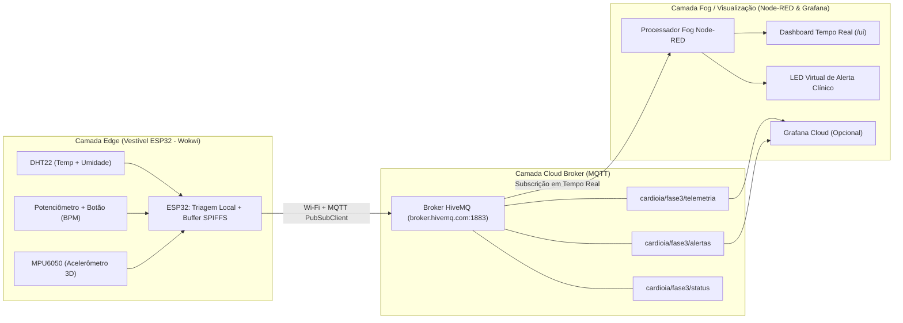
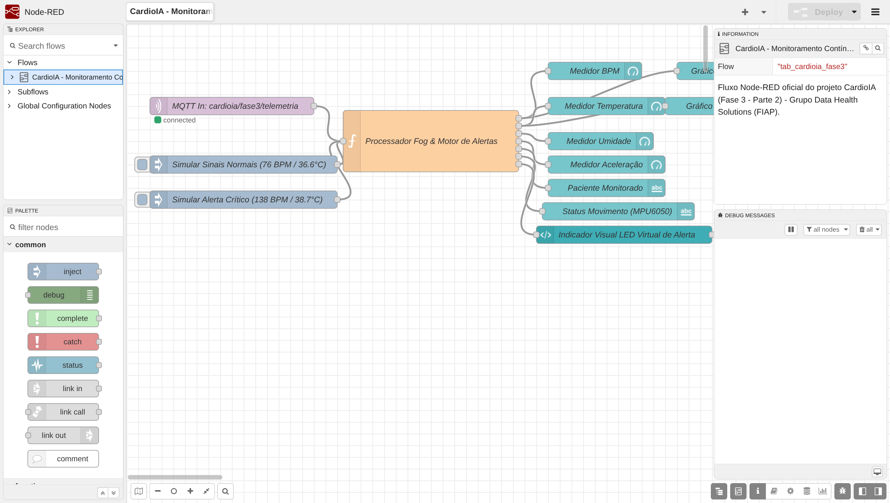
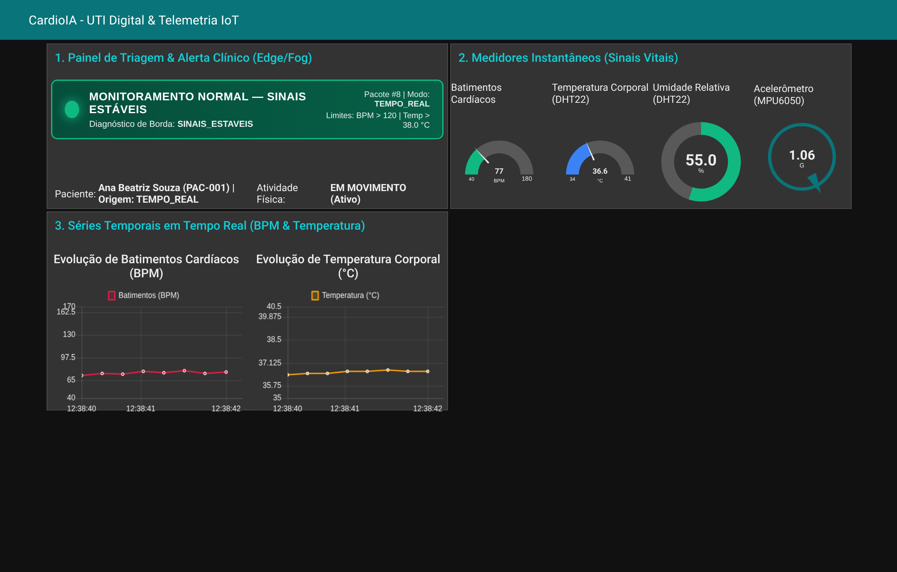
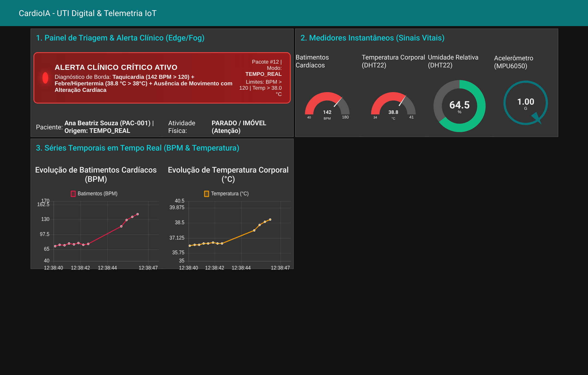

# FIAP — Faculdade de Informática e Administração Paulista

## Relatório Técnico — Parte 2: Transmissão para Nuvem via MQTT e Visualização em Tempo Real (Fog/Cloud Computing & Node-RED)

- **Projeto:** CardioIA Conectada — Fase 3: Monitoramento Contínuo (IoT na Saúde Digital)
- **Grupo:** Data Health Solutions
- **Integrantes:**
  - Gabriel Oliveira dos Santos — RM567166
  - Arthur Bruttel Nascimento — RM568484
  - Jonatan Viotti Rodrigues da Silva — RM566787
  - Samuel Nicolas Oliveira Rocha — RM568552
- **Tutor:** Leonardo Ruiz Orabona | **Coordenador:** André Godoi Chiovato

---

## 1. Visão Geral da Arquitetura Edge → Fog → Cloud

Na **Parte 2**, o protótipo vestível **CardioIA** avança da camada local (*Edge Computing*) para uma arquitetura distribuída completa de **Fog e Cloud Computing**, conectando o microcontrolador **ESP32** na borda a um broker **MQTT** na nuvem (**HiveMQ**) e a uma central de comando clínico visual em tempo real construída no **Node-RED** (com suporte adicional a **Grafana Cloud**).



Essa separação em três camadas resolve os principais gargalos de sistemas de telemedicina:
1. **Camada Edge (ESP32):** Digitaliza os sinais vitais a cada 3 segundos, executa a detecção imediata de anomalias no próprio chip e garante zero perda de pacotes por meio do armazenamento local em SPIFFS (`/leituras_offline.csv`) quando offline.
2. **Camada Cloud Messaging (Broker MQTT HiveMQ):** Desacopla os dispositivos vestíveis dos sistemas hospitalares usando o modelo *Publish/Subscribe* sobre TCP/IP, permitindo que múltiplos consumidores (dashboard Node-RED, Grafana Cloud, API REST e serviço de alertas por e-mail) recebam as leituras simultaneamente.
3. **Camada Fog / Aplicação Clínica (Node-RED Dashboard):** Filtra, enriquece e exibe séries temporais, medidores instantâneos e alertas visuais automáticos para a equipe médica de plantão.

---

## 2. Fluxo de Comunicação MQTT e Integração com o Broker HiveMQ

### 2.1. Por que MQTT em Dispositivos Médicos Vestíveis?
O protocolo **MQTT (Message Queuing Telemetry Transport)** foi escolhido como espinha dorsal de comunicação da Fase 3 por três razões técnicas fundamentais:
- **Baixíssimo Overhead de Rede e Energia:** O cabeçalho fixo de um pacote MQTT possui apenas **2 bytes** (contra centenas de bytes de cabeçalhos HTTP), reduzindo drasticamente o tempo de rádio Wi-Fi ativo e prolongando a bateria do dispositivo vestível do paciente.
- **Mecanismo Nativo de *Last Will and Testament (LWT)*:** Na conexão ao broker (`mqttClient.connect(...)`), o firmware do ESP32 registra uma mensagem de testamento retida (`retain = true`) no tópico `cardioia/fase3/status` com o payload `{"status":"OFFLINE","paciente_id":"PAC-001"}`. Caso a bateria do vestível acabe ou a conexão caia abruptamente, o próprio broker HiveMQ avisa imediatamente o dashboard médico.
- **Reconexão Transparente com Descarga de Fila Offline:** O código em `parte2_mqtt_cloud/sketch.ino` monitora continuamente `WiFi.status()` e `mqttClient.connected()`. Assim que a conexão retorna após um período offline, a função `sincronizarFilaOfflineMQTT()` percorre todas as amostras gravadas no SPIFFS/Buffer Circular e as publica sequencialmente via MQTT com `"origem_envio": "RESILIENCIA_OFFLINE"`.

### 2.2. Configuração do Broker e Árvore de Tópicos MQTT
O firmware conecta-se à rede Wi-Fi virtual do simulador (`SSID: Wokwi-GUEST`) e estabelece sessão com o broker **HiveMQ** (`broker.hivemq.com`, porta TCP `1883`; compatível também com clusters privados **HiveMQ Cloud TLS** na porta `8883` via `WiFiClientSecure`). A hierarquia de tópicos segue o padrão semântico `projeto/fase/recurso`:

| Tópico MQTT | Direção (ESP32) | Tipo de Payload | Descrição e Finalidade |
| :--- | :--- | :--- | :--- |
| `cardioia/fase3/telemetria` | **Publish** (QoS 0) | JSON Estruturado | Canal principal contendo todos os sinais vitais da coleta, metadados do paciente, diagnóstico de borda e origem do envio (`TEMPO_REAL` ou `RESILIENCIA_OFFLINE`). |
| `cardioia/fase3/alertas` | **Publish** (QoS 0) | JSON Estruturado | Canal prioritário acionado exclusivamente quando `alerta_critico == true` (ex.: Taquicardia `> 120 BPM` ou Febre `> 38,0 °C`). |
| `cardioia/fase3/bpm` | **Publish** (QoS 0) | Numérico (`int`) | Frequência cardíaca instantânea em batimentos por minuto (ex.: `76`, `138`). |
| `cardioia/fase3/temperatura` | **Publish** (QoS 0) | Numérico (`float`) | Temperatura corporal/superficial medida pelo DHT22 em °C (ex.: `36.6`, `38.8`). |
| `cardioia/fase3/umidade` | **Publish** (QoS 0) | Numérico (`float`) | Umidade relativa medida pelo DHT22 em % (ex.: `55.0`). |
| `cardioia/fase3/status` | **Publish** (QoS 1, Retain) | JSON Status | Estado de conectividade do vestível (`ONLINE`, `OFFLINE` via LWT ou `OFFLINE_SIMULADO`). |
| `cardioia/fase3/comandos` | **Subscribe** | String Comando | Permite que a equipe médica envie comandos remotos da nuvem para o ESP32 (ex.: `RESET_ALERTA`). |

### 2.3. Exemplo Real de Payload JSON Publicado pelo ESP32
```json
{
  "paciente_id": "PAC-001",
  "paciente": "Ana Beatriz Souza",
  "seq": 12,
  "timestamp_ms": 36000,
  "temperatura_c": 38.8,
  "umidade_pct": 64.5,
  "bpm": 142,
  "aceleracao_g": 1.00,
  "em_movimento": false,
  "alerta_critico": true,
  "nivel_risco": "CRITICO",
  "diagnostico_borda": "ALERTA_COMBINADO_TAQUICARDIA_E_FEBRE",
  "origem_envio": "TEMPO_REAL"
}
```

---

## 3. Configuração do Dashboard no Node-RED e Lógica de Alertas Visuais

O fluxo completo do Node-RED foi exportado no arquivo `dashboard_nodered/flows_nodered.json` utilizando o pacote `node-red-dashboard`.

### 3.1. Estrutura do Fluxo no Editor Node-RED
O fluxo (`CardioIA - Monitoramento Contínuo IoT (Fase 3)`) é composto por:
1. **Nó `mqtt in` (`MQTT In: cardioia/fase3/telemetria`):** Conecta-se ao broker `broker.hivemq.com:1883`, subscreve ao tópico `cardioia/fase3/telemetria` e realiza o *parse* automático do payload JSON recebido do ESP32.
2. **Nós `inject` de Teste Rápido:** Dois botões de injeção manual (*"Simular Sinais Normais (76 BPM / 36.6°C)"* e *"Simular Alerta Crítico (138 BPM / 38.7°C)"*) permitem testar e demonstrar a transição de alertas no dashboard com um único clique, mesmo sem o Wokwi aberto.
3. **Nó `function` (`Processador Fog & Motor de Alertas`):** Possui **7 saídas independentes** que separam as variáveis fisiológicas e aplicam a validação dos limites clínicos definidos pelo grupo:
   - **Batimentos Cardíacos:** Normal entre `50 e 120 BPM` | **Alerta de Taquicardia:** `> 120 BPM` | **Alerta de Bradicardia:** `< 50 BPM`.
   - **Temperatura Corporal (DHT22):** Normal entre `35,0 e 38,0 °C` | **Alerta de Febre/Hipertermia:** `> 38,0 °C` | **Alerta de Hipotermia:** `< 35,0 °C`.
   - **Acelerômetro / Atividade (MPU6050):** Detecta estado `EM MOVIMENTO (Ativo)` vs. `PARADO / IMÓVEL (Atenção)`.



### 3.2. Componentes Visuais do Dashboard (`http://localhost:1880/ui`)
Atendendo integralmente aos requisitos da Parte 2, a interface gráfica foi organizada em três grupos clínicos:

1. **Grupo 1 — Painel de Triagem & Indicador Visual de Alerta (LED Virtual + Texto):**
   - Implementado com um nó `ui_template` estilizado + nós `ui_text` de identificação do paciente (`Ana Beatriz Souza — PAC-001`) e status cinemático do acelerômetro.
   - Quando os sinais vitais estão dentro dos limites seguros, o **LED Virtual brilha em Verde Neon** com o banner `MONITORAMENTO NORMAL — SINAIS ESTÁVEIS`.
   - Quando qualquer parâmetro ultrapassa o limiar crítico (ex.: `BPM > 120` ou `Temperatura > 38,0 °C`), o **LED Virtual comuta instantaneamente para Vermelho Pulsante** com o banner `ALERTA CLÍNICO CRÍTICO ATIVO`, detalhando a causa exata (`Taquicardia (142 BPM > 120) + Febre/Hipertermia (38.8 °C > 38°C)`).
2. **Grupo 2 — Medidores Instantâneos (`ui_gauge`):**
   - **Medidor de Batimentos Cardíacos (BPM):** Escala de `40 a 180 BPM` com faixas de cor dinâmicas (Verde `< 100`, Amarelo `100–120`, Vermelho `> 120 BPM`).
   - **Medidor de Temperatura Corporal (DHT22):** Escala de `34 a 41 °C` (Azul `< 37,5 °C`, Verde `37,5–38,0 °C`, Vermelho `> 38,0 °C`).
   - **Medidor Donut de Umidade Relativa (%):** Escala de `0 a 100%`.
   - **Medidor Compass de Aceleração (MPU6050):** Escala de `0 a 2,5 G`.
3. **Grupo 3 — Gráficos de Séries Temporais em Tempo Real (`ui_chart`):**
   - **Gráfico 1:** *Evolução de Batimentos Cardíacos (BPM)* no eixo temporal (`HH:mm:ss`), permitindo visualizar a curva de aceleração cardíaca e picos de taquicardia.
   - **Gráfico 2:** *Evolução de Temperatura Corporal (°C)* em tempo real.

#### Evidência 1: Dashboard Node-RED em Operação Normal (Sinais Estáveis)


#### Evidência 2: Dashboard Node-RED em Estado de Alerta Clínico Crítico (`> 120 BPM` e `> 38 °C`)


### 3.3. Integração Avançada Opcional com Grafana Cloud
Além do dashboard no Node-RED, disponibilizamos em `dashboard_nodered/grafana_dashboard.json` o modelo completo de dashboard para **Grafana Cloud**, configurado com fonte de dados *MQTT Data Source* apontando para `cardioia/fase3/telemetria`, contendo painéis *Stat*, *Gauge* com *thresholds* clínicos e *Time Series* de alta precisão.

---

## 4. Segurança, Eficiência e Boas Práticas em IoT Médico (LGPD)

Em um cenário produtivo hospitalar ou de *Home Care*, a arquitetura implementada adota quatro pilares de governança e segurança:
1. **Criptografia em Trânsito (MQTT over TLS 1.3):** Migração imediata da porta `1883` (utilizada para fins didáticos no simulador) para a porta `8883` com `WiFiClientSecure`, autenticação mútua por certificados X.509 (`mTLS`) e credenciais de acesso no cluster privado HiveMQ Cloud.
2. **Pseudonimização e Conformidade com a LGPD (Lei nº 13.709/2018):** Dados sensíveis de saúde (Art. 5º, II da LGPD) devem trafegar pseudonimizados na rede IoT utilizando apenas o identificador técnico (`"paciente_id": "PAC-001"`), realizando a associação ao nome civil do paciente exclusivamente dentro do ambiente autenticado do hospital.
3. **Autenticação de Dispositivo e Controle de Acesso (ACL):** Configuração de *Access Control Lists* no broker MQTT para garantir que cada ESP32 só possa publicar no seu próprio subtópico (`cardioia/fase3/pacientes/PAC-001/telemetria`) e nunca ler dados de outros pacientes.
4. **Eficiência Energética na Borda:** Uso de interrupções de hardware (`attachInterrupt`) para contagem de pulsos e transmissão enxuta em JSON/CBOR, minimizando o consumo de corrente do módulo Wi-Fi do ESP32.
